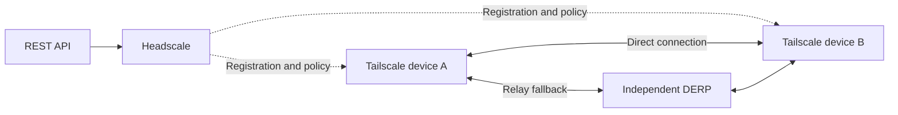

# TailBridge

English | [简体中文](README.zh-CN.md)

TailBridge connects personal devices, home and work networks, and cloud servers through a private network built with Headscale, Tailscale, and self-hosted DERP relays. Use it to access SSH, NAS, remote desktops, and other services across networks.

## Architecture



Headscale manages devices and access policies. Devices exchange WireGuard-encrypted traffic directly, using DERP when a direct connection is unavailable. An authorized exit node can provide Internet access.

## Modules

- **`control` — Headscale:** device registration, discovery, policy distribution, and the management REST API
- **`derp` — Independent relay:** forwards encrypted traffic when devices cannot connect directly; the installer builds `derper`, while certificates and service supervision are configured separately
- **`node` — Tailscale device:** joins the network and can optionally advertise itself as an exit node

## Getting started

The installer supports Ubuntu 26.04 on `amd64` and `arm64`. Follow the [installation guide](docs/INSTALL.md) to deploy `control` and at least one `derp`; they can share a server.

Obtain a node authentication key, then run on each Linux device:

```bash
curl -fsSL https://raw.githubusercontent.com/chinayin/tailbridge/main/install.sh | \
  sudo env SERVER_URL=https://tailbridge.example.net \
    NODE_AUTHKEY='<node-auth-key>' \
    sh -s -- --role node
```

Replace the URL and key with your own. New devices require access grants before they can communicate; see [operations](docs/OPERATIONS.md) for policies and exit routing.

## Environment variables

Pass variables to `sudo env` after the pipe. They configure that installer run; `.env` files are not loaded automatically.

| Variable | Role | Default | Purpose |
| --- | --- | --- | --- |
| `SERVER_URL` | control / node | — | Required control URL, e.g. `https://tailbridge.example.net` |
| `INSTALL_BASE_URL` | control | — | Required template root, e.g. `https://raw.githubusercontent.com/chinayin/tailbridge/main` |
| `BASE_DOMAIN` | control | — | Required MagicDNS domain, e.g. `tb.example.net` |
| `TLS_HOSTNAME`, `ACME_EMAIL` | control | — | Hostname and contact email for automatic certificates |
| `TLS_CERT_PATH`, `TLS_KEY_PATH` | control | — | Certificate and key paths when using file certificates |
| `DERP_REGION_ID`, `DERP_REGION_CODE`, `DERP_REGION_NAME` | control | — | Required ID, code, and display name for the first relay region |
| `DERP_NODE_NAME`, `DERP_HOSTNAME` | control | — | Required relay node name and service domain |
| `DERP_PORT` | control | `443` | Relay port in the map; use `8443` when sharing the control server's IP |
| `DERP_IPV4` | control | — | Optional relay IPv4 address; leave blank to use DNS |
| `NODE_AUTHKEY` | node | — | Registration key for a new device |
| `NODE_HOSTNAME` | node | System hostname | Device name at first registration |
| `ADVERTISE_EXIT_NODE` | node | `false` | Enable forwarding and advertise an exit; approval and access grants are separate |

Choose either automatic or file certificates. `DERP_*` values configure the control plane's relay map; the relay process uses its own startup arguments. Full requirements, examples, and firewall ports are in the [installation guide](docs/INSTALL.md).

## Documentation

Detailed guides are currently in Chinese.

- [Installation and configuration](docs/INSTALL.md)
- [REST management API](docs/API.md)
- [Architecture](docs/ARCHITECTURE.md) · [Design decisions](docs/DESIGN_PROPOSAL.md)
- [Node naming](docs/NODE_NAMING.md)
- [Operations](docs/OPERATIONS.md)
- [Local setup and E2E testing](docs/E2E_TEST_GUIDE.md)

## License

[MIT](LICENSE)
