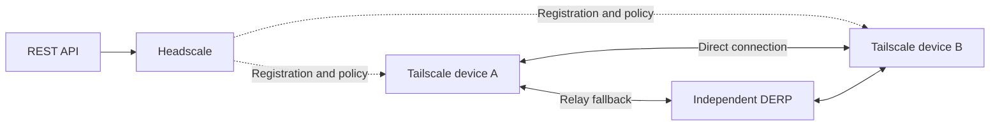

# TailBridge

English | [简体中文](README_CN.md)

TailBridge connects personal devices, home and work networks, and cloud servers through a private network built with Headscale, Tailscale, and self-hosted DERP relays. Use it to access SSH, NAS, remote desktops, and other services across networks.

## Architecture



Headscale manages devices and access policies. Devices exchange WireGuard-encrypted traffic directly, using DERP when a direct connection is unavailable. An authorized exit node can provide Internet access.

## Modules

- **`control` — Headscale:** device registration, discovery, policy distribution, and the management REST API
- **`derp` — Independent relay:** forwards encrypted traffic when devices cannot connect directly; the installer builds `derper` and configures its systemd service, using certificates you provide and renew
- **`node` — Tailscale device:** joins the network and can optionally advertise itself as an exit node

## Getting started

The Bash installer targets Ubuntu 26.04 LTS and is compatible with Ubuntu 26.10 and Debian 13, on `amd64` and `arm64`. Follow the [installation guide](docs/INSTALL.md) to deploy `control` and at least one `derp`; they can share a server, and [one machine can also carry the exit](docs/INSTALL.md#单机部署).

Save a node authentication key as `node-auth.key`, then run on each Linux device:

```bash
curl -fsSL https://raw.githubusercontent.com/chinayin/tailbridge/main/install.sh |
  sudo env SERVER_URL=https://tailbridge.example.net \
    NODE_AUTHKEY_FILE=./node-auth.key \
    bash -s -- --role node
```

Replace the URL with your own. New devices require access grants before they can communicate; see [operations](docs/OPERATIONS.md) for policies and exit routing.

For Mac/Linux registration, daily use, exit selection, and connectivity tests, see the [client guide](docs/CLIENTS.md).

## Environment variables

Variables, defaults, and firewall ports for each role are maintained in the [installation guide](docs/INSTALL.md): [control](docs/INSTALL.md#control-控制面), [derp](docs/INSTALL.md#derp-中继), [node](docs/INSTALL.md#node-设备).

## Documentation

Detailed guides are currently in Chinese.

- [Installation and configuration](docs/INSTALL.md)
- [Mac / Linux clients](docs/CLIENTS.md)
- [REST management API](docs/API_REFERENCE.md)
- [Architecture and design decisions](docs/ARCHITECTURE.md)
- [Node naming](docs/NODE_NAMING.md)
- [Operations](docs/OPERATIONS.md)
- [Deployment skill](skills/tailbridge-deploy/SKILL.md): create cloud hosts (AWS Lightsail by default), deploy and add relay regions
- [Local setup and E2E testing](docs/E2E_TEST_GUIDE.md)

## License

[MIT](LICENSE)
