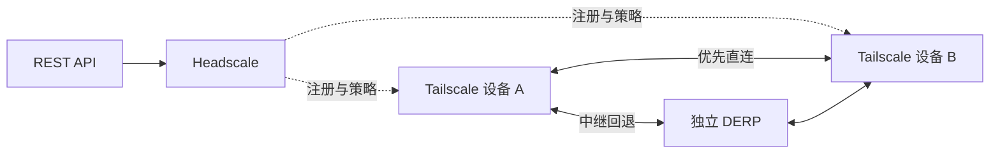

# TailBridge

[English](README.md) | 简体中文

TailBridge 基于 Headscale、Tailscale 和自建 DERP，将个人设备、家庭与工作网络、云服务器接入私有网络，用于跨网络访问 SSH、NAS、远程桌面等服务。

## 项目架构



Headscale 管理设备与访问策略。设备使用 WireGuard 加密通信，无法直连时经 DERP 中继；经授权的出口节点可提供互联网访问。

## 模块

- **`control` — Headscale 控制面**：设备注册、发现、策略下发和管理 REST API
- **`derp` — 独立中继**：无法直连时转发加密流量；安装器构建 `derper` 并配置 systemd 服务，证书由部署方提供和续期
- **`node` — Tailscale 设备**：接入网络，可按需宣告为出口节点

## 如何使用

Bash 安装器以 Ubuntu 26.04 LTS 为标准平台，兼容 Ubuntu 26.10 和 Debian 13（`amd64` / `arm64`）。先按[安装说明](docs/INSTALL.md)部署 `control` 和至少一个 `derp`，两者可以同机。

将节点注册密钥保存为 `node-auth.key` 后，在各 Linux 设备上执行远程安装：

```bash
curl -fsSL https://raw.githubusercontent.com/chinayin/tailbridge/main/install.sh |
  sudo env SERVER_URL=https://tailbridge.example.net \
    NODE_AUTHKEY_FILE=./node-auth.key \
    bash -s -- --role node
```

将地址替换为实际值。新设备需获得访问授权才能互通；策略与出口配置见[运维说明](docs/OPERATIONS.md)。

Mac / Linux 的接入、日常使用、出口切换和连通性测试见[客户端指南](docs/CLIENTS.md)。

## 环境变量

各角色的环境变量、默认值与端口要求统一见[安装说明](docs/INSTALL.md)：[control](docs/INSTALL.md#control-控制面)、[derp](docs/INSTALL.md#derp-中继)、[node](docs/INSTALL.md#node-设备)。

## 相关文档

- [安装与配置](docs/INSTALL.md)
- [Mac / Linux 客户端](docs/CLIENTS.md)
- [REST 管理 API](docs/API.md)
- [架构与设计决策](docs/ARCHITECTURE.md)
- [节点命名](docs/NODE_NAMING.md)
- [运维](docs/OPERATIONS.md)
- [本机体验与 E2E](docs/E2E_TEST_GUIDE.md)

## 开源协议

[MIT](LICENSE)
