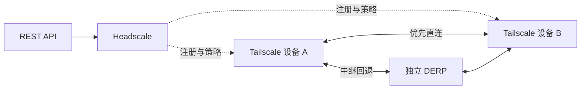

# TailBridge

[English](README.md) | 简体中文

TailBridge 基于 Headscale、Tailscale 和自建 DERP，将个人设备、家庭与工作网络、云服务器接入私有网络，用于跨网络访问 SSH、NAS、远程桌面等服务。

## 项目架构



Headscale 管理设备与访问策略。设备使用 WireGuard 加密通信，无法直连时经 DERP 中继；经授权的出口节点可提供互联网访问。

## 模块

- **`control` — Headscale 控制面**：设备注册、发现、策略下发和管理 REST API
- **`derp` — 独立中继**：无法直连时转发加密流量；安装器构建 `derper` 并配置 systemd 服务，证书由部署方提供和续期
- **`node` — Tailscale 设备**：接入网络，可按需宣告为出口节点

## 如何使用

安装器支持 Ubuntu 26.04（`amd64` / `arm64`）。先按[安装说明](docs/INSTALL.md)部署 `control` 和至少一个 `derp`，两者可以同机。

取得节点注册密钥后，在各 Linux 设备上执行远程安装：

```bash
curl -fsSL https://raw.githubusercontent.com/chinayin/tailbridge/main/install.sh | \
  sudo env SERVER_URL=https://tailbridge.example.net \
    NODE_AUTHKEY='<node-auth-key>' \
    sh -s -- --role node
```

将地址和密钥替换为实际值。新设备需获得访问授权才能互通；策略与出口配置见[运维说明](docs/OPERATIONS.md)。

## 环境变量

变量放在管道后的 `sudo env` 中，安装器将服务配置写入文件，不自动读取 `.env`。服务读取方式见[配置持久化](docs/INSTALL.md#配置持久化)。

| 变量 | 角色 | 默认值 | 用途 |
| --- | --- | --- | --- |
| `SERVER_URL` | control / derp / node | — | 必填控制入口，如 `https://tailbridge.example.net` |
| `INSTALL_BASE_URL` | control / derp | 本仓库 `main` | 可选模板根地址，仅镜像或固定源码版本时覆盖，见[安装说明](docs/INSTALL.md#共用准备) |
| `PROXY` | 全部 | 无 | 可选 HTTP(S) 代理，仅用于安装下载，见[下载代理](docs/INSTALL.md#下载代理) |
| `BASE_DOMAIN` | control | — | 必填 MagicDNS 尾网域，如 `tb.example.net` |
| `TLS_HOSTNAME`、`ACME_EMAIL` | control | — | 自动证书的域名和联系邮箱 |
| `TLS_CERT_PATH`、`TLS_KEY_PATH` | control | — | 文件证书模式的证书和私钥路径 |
| `DERP_REGION_ID`、`DERP_REGION_CODE`、`DERP_REGION_NAME` | control | — | 必填首个中继地域的 ID、代码和显示名 |
| `DERP_NODE_NAME` | control | — | 必填中继节点名 |
| `DERP_HOSTNAME` | control / derp | — | 必填中继服务域名 |
| `DERP_PORT` | control / derp | `443` | Map 和实际监听的中继端口；与控制面共用 IP 时填 `8443` |
| `DERP_CERT_DIR` | derp | `/etc/derper/certs` | 已有证书目录，包含 `<DERP_HOSTNAME>.crt` 和 `.key` |
| `DERP_IPV4` | control | — | 可选中继 IPv4 地址；留空时使用 DNS |
| `NODE_AUTHKEY` | node | — | 新设备首次注册所需的密钥 |
| `NODE_HOSTNAME` | node | 本机 hostname | 首次注册时的设备名称 |
| `ADVERTISE_EXIT_NODE` | node | `false` | 开启转发并宣告出口；仍需控制面批准和访问授权 |

control 的自动证书与文件证书二选一；derp 使用文件证书。两个角色须填写相同的中继域名和端口。完整要求、示例和安全组端口见[安装说明](docs/INSTALL.md)。

## 相关文档

- [安装与配置](docs/INSTALL.md)
- [REST 管理 API](docs/API.md)
- [项目架构](docs/ARCHITECTURE.md) · [设计决策](docs/DESIGN_PROPOSAL.md)
- [节点命名](docs/NODE_NAMING.md)
- [运维](docs/OPERATIONS.md)
- [本机体验与 E2E](docs/E2E_TEST_GUIDE.md)

## 开源协议

[MIT](LICENSE)
