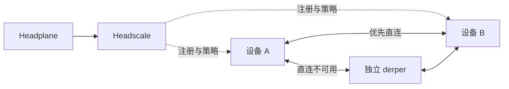

# TailBridge 架构

TailBridge 使用 Headscale、官方 Tailscale 客户端和独立 derper，连接个人设备、家庭、公司及云主机。业务流量优先直连，无法直连时经自建中继转发加密数据。安装接口见 [安装与配置](INSTALL.md)。

## 组件与角色

| 组件 | 职责 |
| --- | --- |
| Headscale | 注册设备、下发节点信息、策略和路由 |
| derper | 提供 DERP 中继和 STUN；每个逻辑区域一个节点 |
| Tailscale | 设备接入，可额外承担子网路由或出口 |
| Headplane | 可选管理界面，停止后不影响已建立的核心连接 |

控制面不转发普通业务流量。derper 通过控制面 `/verify` 校验接入，配置 `-verify-client-url-fail-open=false`。增加中继不等于控制面高可用；控制面停机会影响中继的新接入校验。

控制面只需下发 DERP Map，不要求本机运行 DERP。Headscale 要求启动时 Map 非空；Tailscale 使用 DERP 辅助建立直连并在直连失败时中继。本项目使用自建独立 derper；首次可与控制面同机，按需增加地域，无需提前规划全部节点。[Headscale](https://github.com/juanfont/headscale/blob/v0.29.7/hscontrol/app.go#L616-L627) · [Tailscale](https://github.com/tailscale/tailscale/blob/v1.104.5/cmd/derper/README.md)

## 域名与身份

- `base_domain` 是完整尾网域，如 `tb.example.net`；设备全名为 `<设备名>.<base_domain>`，程序不追加前缀。
- 控制入口 `server_url` 和中继域名必须在尾网域之外，入网前即可访问。[Headscale 约束](https://github.com/juanfont/headscale/blob/v0.29.7/hscontrol/types/config.go#L1263)
- 普通设备沿用本机名；管理用服务器可采用 `tb-derp-hk-01` 等短名，完整地域保留在配置中，见 [节点命名](NODE_NAMING.md)。
- 每台设备保存独立身份；已有有效状态无需再次提供 authkey。初始策略 `grants: []` 拒绝互访，设备注册、访问授权、路由批准分别处理。

出口发布默认路由，经控制面批准并授权后，由客户端主动选择。子网访问另行配置；名称和场景别名不授予权限。操作见 [运维](OPERATIONS.md)。

## 部署与文件

生产标准平台是 Ubuntu 26.04 LTS，兼容 Ubuntu 26.10 和 Debian 13，平台说明见[安装与配置](INSTALL.md)。根目录 `install.sh` 在目标机安装官方组件，`files/` 存配置模板、服务文件和控制面运维工具。control 使用 Headscale 官方 DEB 的 systemd 单元，node 从 Tailscale 官方 apt 源安装；derp 使用项目提供的 `derper.service`，以专用账户运行。

| 内容 | 位置 |
| --- | --- |
| 安装器 / 模板与工具 | `install.sh` / `files/` |
| 云主机创建与部署 skill | `skills/tailbridge-deploy/`：AWS 默认 Lightsail（Debian 13），需要 Ubuntu 26.04 等情况用 EC2；部署输入按主机放在 `local/` |
| E2E 编排与测试 | `tests/e2e/` |
| 本机环境、凭据、报告与私有笔记 | 忽略的 `local/` |
| 控制面配置 / 状态 / 备份 | `/etc/headscale/` / `/var/lib/headscale/` / `/var/backups/headscale/` |
| 控制面运维工具 | `/usr/local/sbin/tbctl`，备份由 `tbctl-backup.timer` 每日执行 |
| 中继配置 / 身份 | `/etc/derper/derper.conf` / `/var/lib/derper/derper.key` |

本机 E2E 用 Compose 在 Ubuntu 容器中执行同一安装器和运维工具。`client-a`、`client-b`、`exit` 是测试场景别名；`probe` 和 `httpbin` 提供普通网络及模拟外网对照。测试范围见 [E2E 说明](E2E_TEST_GUIDE.md#报告与验证范围)。

## 设计决策

| 决策 | 原因 |
| --- | --- |
| Headscale + 官方 Tailscale | 复用现有客户端与协调协议 |
| Headscale 作为唯一登记处 | 节点、策略、路由和 DERP Map 各有权威来源，不另建本机节点清单 |
| 节点通过 REST API 管理，策略和 DERP Map 以文件为准 | 管理 API 共用控制面的 HTTPS 入口；文件由 `tbctl` 校验、原子发布并重载 |
| 目标机运行根目录安装器 | 官方包下载、校验和安装集中在目标机，生产与 E2E 使用同一路径 |
| 完整模板放在 `files/`，用 sed 替换 | 安装逻辑与配置分开维护，在目标机写入实际参数 |
| `config.yaml` 由安装器管理；策略和 DERP Map 只在缺失时初始化 | 重跑即升级，不会清空授权或多区域 Map；`config.yaml` 不同时须 `--force` |
| 独立 derper，每个区域一个节点 | 单机和多机采用同一方式，当前不引入区域内 mesh |
| Tailscale 来自官方 apt 源 | 按发行版与代号选源；首次安装固定版本，之后随 `apt upgrade` 更新；安装器不降级 |
| Headplane 可选 | 管理界面与核心连接分离 |
| 初始拒绝，授权和路由另批 | 入网不自动获得访问其他设备或互联网出口的权限 |
| 默认版本在脚本，Go 由维护者更新 | Headscale / Tailscale 可通过参数覆盖，工具链版本固定 |

## 职责边界与约束

部署方准备 SSH、首次入网凭据、DERP 文件证书和异机备份；安装器按角色安装，有 systemd 时启用并启动服务，node 等 daemon 就绪后注册。无 systemd 时仍准备服务文件和账户，由调用方启动进程及注册节点。设备状态由目标机持久化，实际参数和凭据放在目标机或忽略的 `local/`。

- 安装器与测试统一使用 Bash，启用 `set -euo pipefail` 并执行 ShellCheck；控制面运维工具使用 Python 3 标准库及 PyYAML。
- 输入规则只在 `install.sh` 维护，E2E 通过 `--dry-run` 复用；derper 启动参数只在 `files/derper.service` 维护，E2E 容器读取同一 `ExecStart`。
- 所有候选配置先完成替换与覆盖检查再发布；原生配置和策略校验通过后才能启用或重启服务。
- `--force` 只覆盖 `config.yaml` 和 derper 配置，不改策略、Map 或身份，不自动重新认证；失效或损坏状态保留并报错。
- `--dry-run` 无副作用；离线测试不代替真实组件、服务和网络验收。
- 默认组件版本只在 `install.sh` 顶部维护；文档中的上游链接固定到当时验证的版本，作为引用依据。
