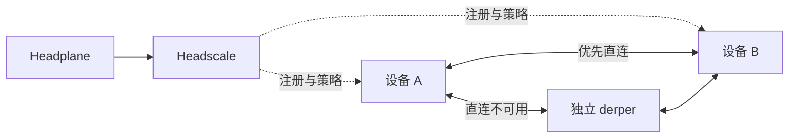

# TailBridge 架构

TailBridge 使用 Headscale、官方 Tailscale 客户端和独立 derper，连接个人设备、家庭、公司及云主机。业务流量优先直连，无法直连时经自建中继转发加密数据。

## 组件与角色

| 组件 | 职责 |
| --- | --- |
| Headscale | 注册设备、下发节点信息、策略和路由 |
| derper | 提供 DERP 中继和 STUN；每个逻辑区域一个节点 |
| Tailscale | 设备接入，可额外承担子网路由或出口 |
| Headplane | 可选管理界面，停止后不影响已建立的核心连接 |

控制面不转发普通业务流量。derper 通过控制面 `/verify` 校验接入，配置 `-verify-client-url-fail-open=false`。增加中继不等于控制面高可用；控制面停机会影响中继的新接入校验。

控制面只需下发 DERP Map，不要求本机运行 DERP。Headscale 要求启动时 Map 非空；Tailscale 使用 DERP 辅助建立直连并在直连失败时中继。本项目使用自建独立 derper；首次可与控制面同机，按需增加地域，无需提前规划全部节点。[Headscale](https://github.com/juanfont/headscale/blob/v0.29.7/hscontrol/app.go#L616-L627) · [Tailscale](https://github.com/tailscale/tailscale/blob/v1.104.5/cmd/derper/README.md)

## 域名与身份

- `base_domain` 是完整尾网域，如 `tb.example.net`；设备全名为 `<设备名>.<base_domain>`，程序不追加前缀。
- 控制入口 `server_url` 和中继域名必须在尾网域之外，入网前即可访问。[Headscale 约束](https://github.com/juanfont/headscale/blob/v0.29.7/hscontrol/types/config.go#L1263)
- 普通设备沿用本机名；管理用服务器可采用 `tb-derp-hk-01` 等短名，完整地域保留在配置中，见 [节点命名](NODE_NAMING.md)。
- 每台设备保存独立身份；已有有效状态无需再次提供 authkey。初始策略 `grants: []` 拒绝互访，设备注册、访问授权、路由批准分别处理。

出口发布默认路由，经控制面批准并授权后，由客户端主动选择。子网访问另行配置；名称和场景别名不授予权限。操作见 [安装与配置](INSTALL.md) 与 [运维](OPERATIONS.md)。

## 部署与文件

生产目标是 Ubuntu 26.04。根目录 `install.sh` 安装官方组件，`files/` 存完整配置模板。control、node 使用官方 systemd 单元；derp 使用项目提供的 `derper.service`，以专用账户运行。部署方负责准备和续期中继证书，见[安装说明](INSTALL.md#derp-中继)。

| 内容 | 位置 |
| --- | --- |
| 安装器 / 配置模板 | `install.sh` / `files/` |
| E2E 编排与测试 | `tests/e2e/` |
| 本机环境、凭据与报告 | 忽略的 `local/` |
| 控制面配置 / 状态 | `/etc/headscale/` / `/var/lib/headscale/` |
| 中继服务 / 身份 | `/etc/systemd/system/derper.service` / `/var/lib/derper/derper.key` |

本机 E2E 用 Compose 在 Ubuntu 容器中执行同一安装器。`client-a`、`client-b`、`exit` 是测试场景别名；`probe` 和 `httpbin` 提供普通网络及模拟外网对照。测试范围与报告位置见 [E2E 说明](E2E_TEST_GUIDE.md#报告与验证范围)。
